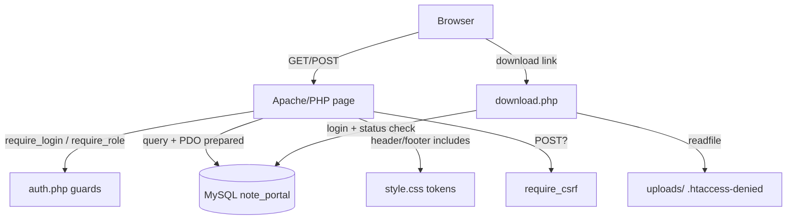

# Title: Student Note Sharing Portal — Architecture

Status: Accepted
Last updated: 2026-10-18

Plain-PHP request/response pages. No framework, no REST layer — each `.php`
file is a route that (a) guards, (b) validates, (c) queries via PDO, (d) renders HTML.

## Route matrix (page × role)

| Page              | Anonymous | Student        | Moderator      | Admin          |
| ----------------- | --------- | -------------- | -------------- | -------------- |
| index.php         | browse*   | browse*        | browse*        | browse*        |
| transparency.php  | view      | view           | view           | view           |
| note.php          | view published** | view own+published; report; bookmark | + moderate pending | same as mod; view removed |
| login/register    | form      | auto-redirect home | auto-redirect | auto-redirect  |
| upload.php        | → login   | new + edit own draft | same        | same           |
| my_notes.php      | → login   | own list       | own list       | own list       |
| bookmarks.php     | → login   | own bookmarks  | own bookmarks  | own bookmarks  |
| review.php        | → login   | 403            | queue/reports/audit | same     |
| admin.php         | → login   | 403            | 403            | full console   |
| download.php      | → login   | published (+ own files) | any non-draft | any |

\* search/filter/tag/pagination. \*\* view counts increment except for the author's own visits.

## Lifecycle notes

- **Session**: cookie `httponly`, `samesite=Lax`, id regenerated on login (fixation defense);
  logout wipes session data, cookie and user cache.
- **Upload**: browser multipart → `store_upload()` (size → finfo MIME → extension via MIME →
  random name `bin2hex(random_bytes(16))` → `move_uploaded_file`) → DB row.
- **Download**: `download.php` is the single gate (`.htaccess` blocks Apache-level serving):
  login first, then note status/ownership checks, then correct `Content-Type` + RFC 5987 filename, then `readfile`.
- **Moderation**: decisions update `notes.status` (+`published_at` on approve) and INSERT into
  `moderation_actions` (append-only; UPDATE/DELETE blocked by triggers). Transparency page reads
  the `_log` view; moderators additionally read the raw table with identities (in-app only).

## Design reference

None applied (D-10 open) — tokens in `assets/style.css` are the de-facto design system.
