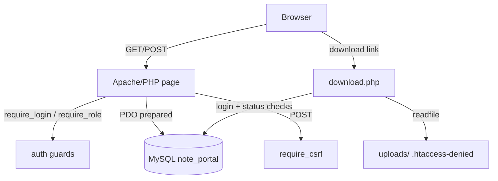

# Student Note Sharing Portal — Project Report (draft)

> Fill in: team names, course code, institution, supervisor (Section 1) and paste
> figures from `screenshots/` (per home/claude/docs/screenshots.md) at the marked
> **[Figure]** points. Everything else is drafted.

## 1. Title page

**Student Note Sharing Portal** — a moderated web platform for sharing and finding
study notes.
Team: [names]. Course: [code]. Institution: Westfield College (working name).
Supervisor: [name]. Academic year: 2026–27.

## 2. Abstract

Students lose study notes across chat groups and drives: material is unvetted,
unsearchable, and disappears with old chats. We built **Student Note Sharing
Portal**, a server-rendered PHP 8 web app on MySQL where students upload notes
(PDF/JPG/PNG, ≤10 MB, ownership attested) as drafts or moderation queue items;
moderators approve, reject with categorized reasons, or remove notes; admins
manage users, roles, and the course taxonomy and see analytics. The public web
can browse and search published notes without an account, while downloads require
login. Four modules go beyond a baseline CRUD portal: an append-only audit trail
(enforced in the database), a per-request transparency log that is redacted *in SQL*,
per-note view/download counters, personal bookmarks, and an admin analytics
dashboard. Security-relevant behavior is server-side: PDO prepared statements,
bcrypt passwords, session hardening, CSRF tokens on every form, upload type/size
sniffing with non-guessable stored names, and web-denied file storage served only
through an authorized `download.php`. The result was smoke-tested end to end with
15 scripted tests (Section 11).

> Keywords: content moderation, transparency, append-only audit, PHP, MySQL, PDO

## 3. Introduction and problem statement

Course notes get shared in chats and personal drives. The specific problems:
(a) no single searchable index, (b) copies without vetting (copyright and quality
risk), (c) institutional knowledge lost as chats clear. Objectives follow the PRD
(home/claude/docs/prd.md): any student can *find* a note in ≤3 clicks, any student can
*publish* a note in ≤2 minutes, and every moderation action is traceable and
transparent to the community in a redacted form.

## 4. Objectives and scope — requirements table

**[Copy the FR-01…FR-11 table from home/claude/docs/Prd.md — statuses and acceptance criteria columns included]**

Differentiating modules chosen by the team to stand apart from other teams on the
same topic:

1. append-only audit trail + public redacted transparency view
2. view/download counters
3. bookmarks (save for later)
4. admin analytics dashboard (totals, weekly publish bars, top downloads, approval time)

Out of scope: real-time collaboration, payments, native apps, AI features, malware scanning.

## 5. System analysis

Problem analysis followed user journeys (home/claude/docs/user-journeys.md).
Key decision debates from the pre-build phase (superseded stack in parentheses)
are summarized in Section 15; the current decision set lives in
home/claude/docs/decisions.md.

## 6. Design — architecture

Server-rendered pages; one PHP file is one route, and files that share concerns
live in `includes/` (db, auth, functions, header, footer). There is no REST layer:
every page guards → validates → queries → renders.

**[Figure: architecture diagram — mermaid version below, re-render as image]**

**[Figure: route matrix screenshot — architecture.md §Route matrix]**

## 7. Design — database

Tables bridged from the security-driven pre-build draft: institutions, users
(bcrypt hash only), courses, subjects, notes (status enum, non-guessable `file_ref`,
counters, `FULLTEXT(title, description)`), tags/note_tags, reports
(UNIQUE(note_id, reporter_id)), moderation_actions (**append-only enforced with
UPDATE/DELETE triggers that SIGNAL**), bookmarks. A SQL-level view
`transparency_log` exposes only redacted columns — actor identity, internal notes
and reporter identity are *structurally* absent (privacy by construction, not by CSS).

**[Figure: ER diagram — screenshots/24-er-diagram.png]**

**[Paste the table map from home/claude/docs/backend-schema.md]**

## 8. Implementation — modules (code walkthrough)

| Module | Files | Highlights |
| ------ | ----- | ---------- |
| Data access | includes/db.php | one PDO, emulation off — real prepares |
| Auth | includes/auth.php | guards, `session_regenerate_id`, cache invalidation on login |
| Validation/helpers | includes/functions.php | `e()`, CSRF, flash, `store_upload()` (finfo MIME → random name) |
| Browse | index.php | FULLTEXT boolean search, subject/course/tag filters, pagination |
| Note detail | note.php | visibility by row status/owner/role; counters; report; inline moderation |
| Download | download.php | login + status gate, correct MIME, RFC 5987 filename, counter |
| Upload | upload.php | grouped subjects, tags, attestation-required; drafts and re-submits |
| My notes | my_notes.php | status chips; draft edit/delete (file unlinked); re-submit |
| Moderation | review.php | queue, report inbox, spot removal, audit table |
| Admin | admin.php | users/roles (self-demotion blocked), taxonomy with FK guards, analytics |
| Transparency | transparency.php | reads the redacted view |

## 9. Implementation — differentiators (detail)

1. **Audit + transparency**: INSERT-only via triggers; public page reads a *view*
   whose SELECT omits identity columns. Even a compromised template cannot leak
   reporter names — they are not in the result set.
2. **Counters**: `view_count` (skips the author's own visits) and `download_count`
   (increments inside the authorized download path).
3. **Bookmarks**: composite-key table (one row per user–note), toggled on note pages.
4. **Analytics**: stat chips, 8-week `YEARWEEK` publish bars (pure CSS), top
   downloads table, average approval hours; no chart library (offline-safe).

## 10. Security and privacy

Paste the controls table from home/claude/docs/security.md. Residual risks, stated
honestly: no malware scanning of uploads (mitigated by type whitelist + demo
environment), no rate limiting/lockout (coursework scale), password reset not
implemented (admin-assisted in v1), audit-table growth unbounded by design.

## 11. Testing

**[Paste testing.md §01–15 results table: all pass]**
Then the module → case → expected table from home/claude/docs/testing.md
(± automated syntax checks across 19 files).

## 12. Screenshots and flows

**[Figures 01–24; combined role flows annotated with 2–3 sentences each — screenshots.md]**

## 13. Installation guide

Copy from home/claude/docs/deployment.md (Option A: XAMPP — import note_portal.sql,
copy folder to htdocs, open /student-note-portal/, three seeded accounts).

## 14. Limitations and future work

Residual security rows above; naming/design-reference decisions open (D-P09/P10);
public hosting decision (D-P11); optional future: malware scanning hook, soft quota
per user, SSO with the college domain, REST API for mobile app.

## 15. Conclusion

All eleven functional requirements shipped with acceptance criteria verified by
the scripted smoke tests; the moderation workflow is demonstrably traceable and
publicly transparent in redacted form. Stack discipline (PHP+MySQL only, zero
runtime dependencies) kept the deliverable self-contained: the project runs from
a single folder and one .sql import.

## 16. References

1. PHP Manual — password_hash, finfo, session, PDO.
2. MySQL 8.0 Reference Manual — FULLTEXT, triggers, CHECK constraints, views.
3. OWASP Cheat Sheet Series — Authentication, CSRF, XSS, File Upload.
4. Project documentation set — home/claude/docs/.
